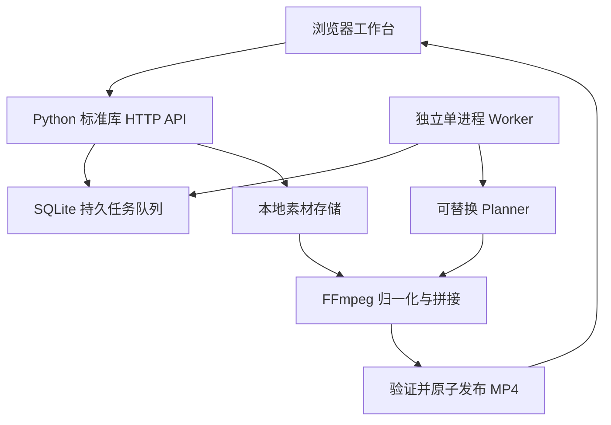

# cut

Web 版 AI 信息流自动剪辑系统的最小可运行起点：上传商品素材，按类别批量创建任务，由独立 Worker 渲染并下载真实 MP4。

**当前使用本地规则规划器，不调用 AI 模型。** 无需任何云账号或密钥。支持用户填写任意商品类别，但不自动识别商品。默认批量 10 条，最多 20 条；随机顺序和有效起点生成变体，短素材会重复，不保证变体唯一。首版无字幕、配音、配乐、转场，素材原音默认移除。

## 最小架构



| 目录 / 文件 | 职责 |
| --- | --- |
| `frontend/index.html` | 上传、分类选择、批量生成、状态轮询、下载、失败重试 |
| `backend/server.py` | 同源网页与 HTTP API |
| `backend/core.py` | SQLite 模型、参数校验、Planner / Storage 接口与默认实现 |
| `backend/media.py` | FFprobe 校验、FFmpeg 截取、编码和拼接 |
| `backend/worker.py` | 持久任务消费、进度更新、失败处理和重启恢复 |
| `tests/test_pipeline.py` | 真实 FFmpeg 端到端验证 |
| `.env.example` | 环境变量模板 |
| `data/` | 运行时生成的数据库、素材和成片，不入 Git |

## 启动步骤

要求 **Python 3.11+、FFmpeg、FFprobe**，FFmpeg 需带 `libx264`。支持 macOS、Linux；Windows 请用 WSL2（Worker 使用 POSIX 文件锁）。无需安装 Python 第三方包、Node.js 或云服务。

先通过本机软件包管理器安装 Python 与 FFmpeg，再执行：

```bash
git clone https://github.com/tiamoqaq-commits/cut.git
cd cut
# 本提交尚未合并时，需要切换到对应 PR 分支：
# git switch codex/local-video-mvp
cp .env.example .env
python3 --version
ffmpeg -version
ffprobe -version
# 终端 A，从仓库根目录启动：
python3 -m backend.server
```

另开终端 B，进入同一仓库根目录：

```bash
python3 -m backend.worker
```

打开 <http://127.0.0.1:8000>：填写类别（如手串、食品、家居）→ 上传视频 → 勾选同类别素材 → 设置数量、成片时长、镜头时长 → 开始生成 → 下载 succeeded 的 MP4。类别不混剪。只有 Worker 启动后队列才会被处理。Ctrl+C 停止进程。

测试（在仓库根目录）：

```bash
python3 -m unittest discover -s tests -v
```

测试自动生成彩条视频，实际验证上传、非法文件拒绝、类别隔离、两条批量任务、API 重启后队列保留，以及下载视频的 H.264 编码、720×1280 分辨率和时长。不调用外部服务。

## 环境变量

复制 `.env.example` 为 `.env`；程序自动读取，已设置的进程环境变量优先。API 与 Worker 必须使用相同数据目录配置。

| 变量 | 默认值 / 用途 |
| --- | --- |
| `CUT_PORT` | 8000；API 固定只监听 127.0.0.1 |
| `CUT_DATA_DIR` | 仓库根目录下 data；建议配置绝对本地路径 |
| `CUT_MAX_UPLOAD_MB` | 200；单个上传文件大小上限 |
| `CUT_PLANNER` | rules；当前只实现规则规划 |
| `CUT_STORAGE` | local；当前只实现本地存储 |
| `FFMPEG_BIN` / `FFPROBE_BIN` | ffmpeg / ffprobe；可填写程序绝对路径 |

没有预设模型供应商、对象存储、云地域或账号。填入未实现的 planner / storage 会明确启动失败，不会默默使用其他服务。

## 批量生成接口

| 方法 | 路径 | 说明 |
| --- | --- | --- |
| POST | `/api/assets?name=demo.mp4&category=food` | 请求体为二进制文件，需 Content-Length；返回 id、类别和时长 |
| GET | `/api/assets` | 查看已上传素材 |
| POST | `/api/batches` | JSON 创建批量任务；202 返回 batch_id 和 status_url |
| GET | `/api/batches/{batch_id}` | 查看批次全部任务 |
| GET | `/api/jobs` | 最近 200 条任务 |
| GET | `/api/jobs/{job_id}` | 单任务详情与剪辑计划 |
| POST | `/api/jobs/{job_id}/retry` | 请求体 `{}`；仅失败任务可重新排队 |
| GET | `/api/jobs/{job_id}/output` | 成功后下载 MP4 |
| GET | `/api/health` | API 可用性；不代表 Worker 已启动 |

```bash
curl --data-binary @demo.mp4 \
  'http://127.0.0.1:8000/api/assets?name=demo.mp4&category=food'

curl -X POST http://127.0.0.1:8000/api/batches \
  -H 'Content-Type: application/json' \
  -d '{"asset_ids":["替换为上传响应的素材ID"],"category":"food","count":10,"duration":15,"clip_seconds":3}'
```

约束：素材 ID 1–30 个且不重复，全部必须属于请求类别；count 为 1–20 整数，duration 为 1–60 秒整数，clip_seconds 为 1–10 秒整数。每个素材时长须为 0.1–3600 秒。校验失败返回 400，不会创建半个批次。上传过大返回 413，不接受外部素材 URL。

## 视频任务模型

每条 job 对应一个 MP4，batch_id 关联一批任务，批量插入使用数据库事务。

| 字段 | 说明 |
| --- | --- |
| `id`, `batch_id` | 服务端生成 UUID |
| `status` | queued → running → succeeded / failed；failed 可显式重试 |
| `request` | JSON：asset_ids、category、count、duration、clip_seconds |
| `plan` | JSON 镜头列表：asset_id、start、duration；单位秒 |
| `progress` | 0–100，按已渲染片段估算进度 |
| `output_key` | 完成文件的存储键，成功后提供 download_url |
| `error` | 失败信息，最多 2000 字符 |
| `attempts` | Worker 实际领取任务的次数 |
| `created_at`, `updated_at` | UTC ISO 时间 |

SQLite 素材表保存 id、原始文件名、类别、时长、创建时间，真实文件名使用服务端 UUID。参数持久化，浏览器关闭不影响任务。单条失败不阻塞批次其他任务。

Worker 通过 SQLite 事务领取任务；每个数据目录只运行一个 Worker，以文件锁防止重复启动。Worker 重启会将 running 任务重新排队，从头渲染，随机种子使用 job ID，因此同任务重试可复现规则计划。成片已发布但状态尚未更新时若崩溃，重试覆盖相同输出键。此版本不提供多机分布式锁或断点续渲。

## MP4 输出流程

1. 上传落地并用 FFprobe 验证存在视频流、时长合法；无效文件删除。
2. Planner 选择素材顺序、有效起点和时长，保存剪辑计划。
3. FFmpeg 按计划截取并归一化：**720×1280，30fps，H.264，yuv420p，无音轨**；保持比例，空白处补黑边。
4. 将统一编码后的片段 concat，设置 `+faststart` 前置 MP4 索引。
5. FFprobe 验证成片；先复制到目标磁盘临时文件，再原子替换发布，最后更新 succeeded。
6. 浏览器通过输出接口下载 MP4。每次 FFmpeg 调用超时为 300 秒，失败落库，可点击重试。

## 可替换接口与后续扩展

| 边界 | 当前实现 | 替换要求 |
| --- | --- | --- |
| `Planner.plan(assets, request, seed)` | RulePlanner，返回 `list[Clip]` | 任意模型或商品模板；接入时校验模型输出素材 ID、起止范围与资源预算 |
| `Storage.local_path(key)` | 本地路径 | 云适配器负责把输入下载 / 缓存到本地 |
| `Storage.publish(local_file, key)` | 原子替换本地文件 | 云适配器负责上传；输出下载接口可改为签名 URL |
| 队列 / Repository | SQLite connect、claim、状态更新 | 扩展 PostgreSQL / Redis 时抽取 Repository，并增加租约、心跳、幂等 |
| 渲染器 | 本地 FFmpeg | 可迁移受限容器或独立渲染服务，继续使用镜头计划契约 |

实际装配点是 `backend/core.py` 的 `providers()`。模型、OSS / S3、消息队列均未实现，接入任一供应商时自行注册适配器并新增所需环境变量；不需要提前注册无关账号。

## 当前使用边界

本项目用于可信本机、单用户验证。标准库 HTTP 服务无鉴权，不适合直接开放公网；固定监听 loopback。上传校验不等于恶意媒体隔离。上线前应增加鉴权、配额与限流、沙箱渲染、任务与磁盘清理、对象存储下载、监控；多 Worker 前先替换队列并实现租约。

MVP 不自动删除输入或成片，以支持重试；请监控磁盘，停机后备份或清理 data 目录。SQLite 数据目录不要使用网络共享盘。

下一步建议顺序：真实商品素材验收 → 商品模板 → 字幕与配音 → AI 镜头选择 → 按实际并发升级存储和队列。
