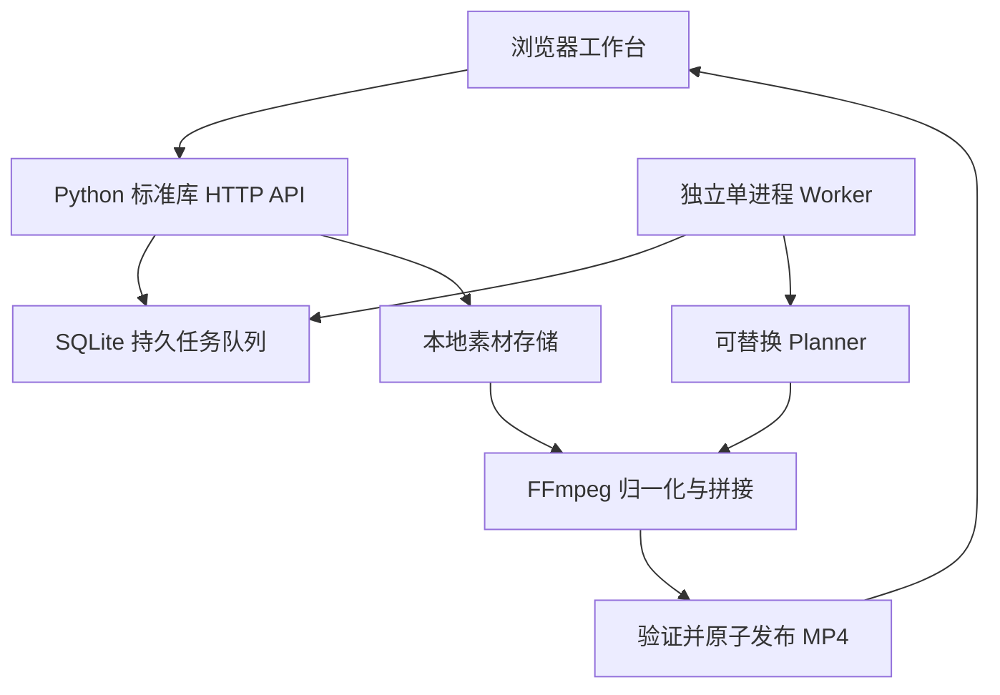

# cut

Web 版 AI 信息流自动剪辑系统的最小可运行起点：上传商品素材，按类别批量创建任务，由独立 Worker 渲染并下载真实 MP4。

**支持规则剪辑或可配置 AI 镜头规划，支持手写 / AI 文案字幕烧录和 SRT 下载。** 规则模式无需模型账号；AI 模式需自行配置兼容接口。类别由用户填写，不自动识别商品。默认每批 10 条，最多 20 条；短素材可能重复，不保证变体唯一。支持千问 AI 配音＋上传背景音乐；暂无语音转写或转场，素材原音默认移除。

## 最小架构



| 目录 / 文件 | 职责 |
| --- | --- |
| `frontend/index.html` | 上传、分类选择、批量生成、状态轮询、下载、失败重试 |
| `backend/server.py` | 同源网页与 HTTP API |
| `backend/core.py` | SQLite 模型、参数校验、Planner / Storage 接口与默认实现 |
| `backend/ai.py` | Chat Completions 兼容模型调用与严格时间轴校验 |
| `backend/subtitles.py` | 字幕时间轴、SRT 导出和安全 ASS 样式 |
| `backend/audio.py` | 千问逐句 TTS、缓存、时间轴对齐、背景音乐循环与混音 |
| `backend/media.py` | FFprobe 校验、FFmpeg 截取、编码和拼接 |
| `backend/worker.py` | 持久任务消费、进度更新、失败处理和重启恢复 |
| `tests/test_pipeline.py` | 真实 FFmpeg 端到端验证 |
| `.env.example` | 环境变量模板 |
| `data/` | 运行时生成的数据库、素材和成片，不入 Git |

## 启动步骤

要求 **Python 3.11+、FFmpeg、FFprobe**，FFmpeg 需带 `libx264` 和字幕用的 `libass`。中文烧录还需 fontconfig 和中文字体。支持 macOS、Linux；Windows 请用 WSL2（Worker 使用 POSIX 文件锁）。无需安装 Python 第三方包、Node.js 或云服务。

先通过本机软件包管理器安装 Python 与 FFmpeg，再执行：

```bash
git clone https://github.com/tiamoqaq-commits/cut.git
cd cut
# 本提交尚未合并时，需要切换到对应 PR 分支：
# git switch codex/local-video-mvp
cp .env.example .env
python3 --version
ffmpeg -version
ffprobe -version
# 终端 A，从仓库根目录启动：
python3 -m backend.server
```

另开终端 B，进入同一仓库根目录：

```bash
python3 -m backend.worker
```

打开 <http://127.0.0.1:8000>：填写类别（如手串、食品、家居）→ 上传视频 → 勾选同类别素材 → 设置数量、成片时长、镜头时长 → 开始生成 → 下载 succeeded 的 MP4。类别不混剪。只有 Worker 启动后队列才会被处理。Ctrl+C 停止进程。

测试（在仓库根目录）：

```bash
python3 -m unittest discover -s tests -v
```

测试自动生成彩条视频，实际验证上传、非法文件拒绝、类别隔离、规则 / 模拟 AI 批量任务、API 重启后队列保留，以及成片编码、分辨率、时长、字幕区域像素变化和 SRT 下载。单元测试检查非法模型计划、字幕转义与缺失字体。模型调用使用本机模拟服务，未验证真实外部账号。

## 环境变量

复制 `.env.example` 为 `.env`；程序自动读取，已设置的进程环境变量优先。API 与 Worker 必须使用相同数据目录配置。

| 变量 | 默认值 / 用途 |
| --- | --- |
| `CUT_PORT` | 8000；API 固定只监听 127.0.0.1 |
| `CUT_DATA_DIR` | 仓库根目录下 data；建议配置绝对本地路径 |
| `CUT_MAX_UPLOAD_MB` | 200；单个上传文件大小上限 |
| `CUT_PLANNER` | rules；默认规划器，可设为 chat |
| `CUT_STORAGE` | local；当前只实现本地存储 |
| `FFMPEG_BIN` / `FFPROBE_BIN` | ffmpeg / ffprobe；可填写程序绝对路径 |

没有预设模型供应商、对象存储、云地域或账号。planner 支持 rules / chat，storage 当前仅支持 local；其他值明确报错。

## 批量生成接口

| 方法 | 路径 | 说明 |
| --- | --- | --- |
| POST | `/api/assets?name=demo.mp4&category=food` | 请求体为二进制文件，需 Content-Length；返回 id、类别和时长 |
| GET | `/api/assets` | 查看已上传素材 |
| POST | `/api/batches` | JSON 创建批量任务；202 返回 batch_id 和 status_url |
| GET | `/api/batches/{batch_id}` | 查看批次全部任务 |
| GET | `/api/jobs` | 最近 200 条任务 |
| GET | `/api/jobs/{job_id}` | 单任务详情与剪辑计划 |
| POST | `/api/jobs/{job_id}/retry` | 请求体 `{}`；仅失败任务可重新排队 |
| GET | `/api/jobs/{job_id}/output` | 成功后下载 MP4 |
| GET | `/api/jobs/{job_id}/subtitles` | 成功且启用字幕后下载 SRT |
| GET | `/api/health` | API 可用性；不代表 Worker 已启动 |

```bash
curl --data-binary @demo.mp4 \
  'http://127.0.0.1:8000/api/assets?name=demo.mp4&category=food'

curl -X POST http://127.0.0.1:8000/api/batches \
  -H 'Content-Type: application/json' \
  -d '{"asset_ids":["替换为上传响应的素材ID"],"category":"food","count":10,"duration":15,"clip_seconds":3}'
```

约束：素材 ID 1–30 个且不重复，全部必须属于请求类别；count 为 1–20 整数，duration 为 1–60 秒整数，clip_seconds 为 1–10 秒整数。每个素材时长须为 0.1–3600 秒。校验失败返回 400，不会创建半个批次。上传过大返回 413，不接受外部素材 URL。

## 视频任务模型

每条 job 对应一个 MP4，batch_id 关联一批任务，批量插入使用数据库事务。

| 字段 | 说明 |
| --- | --- |
| `id`, `batch_id` | 服务端生成 UUID |
| `status` | queued → running → succeeded / failed；failed 可显式重试 |
| `request` | JSON：asset_ids、category、count、duration、clip_seconds |
| `plan` | JSON 镜头列表：asset_id、start、duration；单位秒 |
| `progress` | 0–100，按已渲染片段估算进度 |
| `output_key` | 完成文件的存储键，成功后提供 download_url |
| `error` | 失败信息，最多 2000 字符 |
| `attempts` | Worker 实际领取任务的次数 |
| `created_at`, `updated_at` | UTC ISO 时间 |

SQLite 素材表保存 id、原始文件名、类别、时长、创建时间，真实文件名使用服务端 UUID。参数持久化，浏览器关闭不影响任务。单条失败不阻塞批次其他任务。

Worker 通过 SQLite 事务领取任务；每个数据目录只运行一个 Worker，以文件锁防止重复启动。Worker 重启会将 running 任务重新排队，从头渲染；已持久化的规划直接复用，不重复调用模型。模型响应成功但计划尚未入库时崩溃，重启仍可能再次调用模型。成片已发布但状态尚未更新时若崩溃，重试覆盖相同输出键。此版本不提供多机分布式锁或断点续渲。

## MP4 输出流程

1. 上传落地并用 FFprobe 验证存在视频流、时长合法；无效文件删除。
2. Planner 选择素材顺序、有效起点和时长，保存剪辑计划。
3. FFmpeg 按计划截取并归一化：**720×1280，30fps，H.264，yuv420p（归一化阶段移除素材原音，随后可加配音＋配乐）**；保持比例，空白处补黑边。
4. 将统一编码后的片段 concat；如启用字幕，生成 SRT / ASS 并用 libass 烧录，重新编码后设置 `+faststart`。
5. FFprobe 验证成片；先复制到目标磁盘临时文件，再原子替换发布，最后更新 succeeded。
6. 浏览器通过输出接口下载 MP4。每次 FFmpeg 调用超时为 300 秒，失败落库，可点击重试。

## 可替换接口与后续扩展

| 边界 | 当前实现 | 替换要求 |
| --- | --- | --- |
| `Planner.plan(assets, request, seed)` | RulePlanner / ChatPlanner，返回 `list[Clip]` | 可接其他模型；现有 ChatPlanner 已校验素材 ID、有限时间值、单镜头时长、总时长和字幕长度 |
| `Storage.local_path(key)` | 本地路径 | 云适配器负责把输入下载 / 缓存到本地 |
| `Storage.publish(local_file, key)` | 原子替换本地文件 | 云适配器负责上传；输出下载接口可改为签名 URL |
| 队列 / Repository | SQLite connect、claim、状态更新 | 扩展 PostgreSQL / Redis 时抽取 Repository，并增加租约、心跳、幂等 |
| 渲染器 | 本地 FFmpeg | 可迁移受限容器或独立渲染服务，继续使用镜头计划契约 |

实际装配点是 `backend/core.py` 的 `providers()`。ChatPlanner 已实现 Chat Completions 兼容接口；其他协议、OSS / S3、消息队列需自行注册适配器。无需提前注册无关账号。

## 当前使用边界

本项目用于可信本机、单用户验证。标准库 HTTP 服务无鉴权，不适合直接开放公网；固定监听 loopback。上传校验不等于恶意媒体隔离。上线前应增加鉴权、配额与限流、沙箱渲染、任务与磁盘清理、对象存储下载、监控；多 Worker 前先替换队列并实现租约。

MVP 不自动删除输入或成片，以支持重试；请监控磁盘，停机后备份或清理 data 目录。SQLite 数据目录不要使用网络共享盘。

下一步建议顺序：真实商品素材、字幕与声音验收 → 视觉分析 / 语音转写 → 按实际并发升级存储和队列。


## AI 模型接入与字幕使用

### 1. 配置兼容模型

在 `.env` 中填写你已经选择的服务；无需把密钥提交到 Git 或输入网页：

```dotenv
CUT_LLM_BASE_URL=https://你的服务域名/v1
CUT_LLM_MODEL=你的模型名称
CUT_LLM_API_KEY=你的密钥
CUT_LLM_TIMEOUT=90
CUT_LLM_JSON_MODE=0
CUT_SUBTITLE_FONT=Noto Sans CJK SC
```

`CUT_LLM_BASE_URL` 是 API 前缀，代码追加 `/chat/completions`。支持 HTTPS 服务或本机 HTTP（如 `http://127.0.0.1:1234/v1`）；本机无鉴权服务可留空密钥。选择支持 Chat Completions 的模型，不是所有模型协议都兼容；支持 JSON mode 时可设 `CUT_LLM_JSON_MODE=1`，否则保持 0，通过提示词要求 JSON 并在本地严格校验。接口参考：[Chat Completions](https://developers.openai.com/api/reference/resources/chat/subresources/completions/methods/create)。

保存后重启 API 和 Worker。网页中选择“AI 规划”，填写真实商品说明和素材描述。选择 AI 字幕必须填写商品说明。默认不设置云服务或具体模型，不会读取 ChatGPT 订阅凭据。

**模型实际收到的内容**：商品说明、类别、素材 ID、文件名、素材时长、目标时长、镜头时长和变体标识。不上传视频 / 音频，因此这是基于文本元数据的镜头规划与文案生成，不是视觉理解或原声语音转写。文件名若含私人信息也会随请求发送。

每条 AI 成片调用一次模型，10 条通常对应 10 次请求，可能产生所选服务费用。无自动模型重试或静默回退。HTTP 错误、超时、非法 JSON、未知素材、越界时间轴、镜头时间参数非法会标记 failed；仅总时长不符时由本地时间轴自动适配。错误只记录状态码或通用说明，不保存供应商原始错误正文和密钥。有效计划先入库，后续渲染失败重试复用该计划；模型本身失败时，手动重试会重新请求。

### 2. 安装字幕依赖

确认 `ffmpeg -filters` 中有 `ass`。中文字体缺失时任务会给出明确错误，不会静默生成空白方块。Linux 可安装 `fontconfig` 与 `fonts-noto-cjk`，macOS 可使用安装好的中文字体并配置 family（如 `PingFang SC`），同时安装 fontconfig。验证命令：

```bash
fc-list :lang=zh family
```

`CUT_SUBTITLE_FONT` 填字体 family 名称，不是字体路径；libass 可使用系统字体回退。默认白字黑描边、底部居中、离底部 100 像素，每 18 字自动换行。字幕文本会转义 ASS 控制序列，无法注入位置或样式命令。

### 3. 三种字幕模式

| subtitle_mode | 网页选项 | 行为 |
| --- | --- | --- |
| none | 不添加 | 输出无字幕视频 |
| manual | 手写字幕 | 每行一句，按最终成片时长均分；支持规则或 AI 规划 |
| ai | AI 生成文案字幕 | 每个镜头生成一句文案，与镜头时间轴对齐；要求 planner=chat 和商品说明 |

手写最多 60 句，每句 1–48 字，平均每句至少 0.5 秒。AI 每句最多 48 字；可在任务详情中查看镜头和字幕，并下载 SRT。字幕已硬烧录进 MP4，即使播放器不加载 SRT 也可见。该版本没有字幕编辑后重新渲染按钮；修改文案请以 manual 模式新建批次。AI 文案需核对真实性；预览详情不代表已人工审核。

新增请求示例：

```json
{
  "asset_ids": ["上传得到的素材ID"],
  "category": "手串",
  "count": 10,
  "duration": 15,
  "clip_seconds": 3,
  "planner": "chat",
  "product_brief": "紫金鼠素串，焦糖棕色。closeup.mp4 是珠子特写。",
  "subtitle_mode": "ai",
  "subtitle_lines": []
}
```

如只要手写字幕，将 planner 改为 rules，subtitle_mode 改为 manual，subtitle_lines 填入字符串数组。旧请求缺省仍为 rules + none，无需迁移数据库；新参数保存在原有 request JSON，镜头 plan 新增 text 字段。


## AI 配音＋背景音乐

此功能输出带 **AAC 48kHz 双声道**音轨的 MP4：朗读字幕文案，叠加你上传的音乐。默认 `audio_mode=none`，旧请求与旧任务继续无声；要添加声音必须创建新批次。素材原音不参与这个组合。

### Mac 更新现有项目

1. 停止 Server 和 Worker，备份原项目目录。
2. 下载 `codex/local-video-mvp` 分支的新代码，将其中 backend、frontend、tests、README.md、.env.example 更新到原项目。**保留原来的 .env 和整个 data 文件夹**；不要用示例覆盖密钥和 FFmpeg 路径。
3. 按下文在原 .env 追加 TTS 配置。同名配置只留一份。
4. 从原项目根目录分别启动 `python3 -m backend.server` 和 `python3 -m backend.worker`。刷新网页，应该出现声音、上传音乐和音乐选择控件。
5. 如本机仍有已知的绝对路径数据库打开问题，可继续从项目根目录使用原临时 Worker 启动命令：`python3 -c 'from backend import core; core.DB = "data/cut.sqlite3"; from backend.worker import main; main()'`。

数据库连接现在在每次事务结束后显式关闭，避免长期轮询依赖垃圾回收而累积连接；这修复连接生命周期问题，但不能保证解决所有本机路径 / 权限错误。

### 千问 TTS 配置

保留已经能工作的 CUT_LLM_*，另外追加以下配置（**北京地域示例**）：

```dotenv
CUT_TTS_URL=https://dashscope.aliyuncs.com/api/v1/services/aigc/multimodal-generation/generation
CUT_TTS_MODEL=qwen3-tts-flash
CUT_TTS_VOICE=Cherry
CUT_TTS_API_KEY=替换成北京地域百炼API密钥
```

如果你现有千问密钥属于北京地域且有该语音模型权限，可将它填入 CUT_TTS_API_KEY；程序不会自动读取或复用聊天密钥。其他地域必须使用对应语音 endpoint 和密钥，不能把 Chat Completions 的 compatible-mode URL 直接填入 TTS URL。

参考：[千问非实时语音合成官方文档](https://help.aliyun.com/zh/model-studio/qwen-tts-api)。默认是系统音色 Cherry，不涉及声音克隆。开通模型服务、可用地域、权限、额度和费用以你自己的百炼账号为准。真实外部模型尚未在本开发环境联调。

### 网页操作

1. 上传并勾选视频，选择 AI 规划和 AI 字幕，填写真实商品说明；也可使用手写字幕作为朗读文案。
2. 声音选择“AI 配音＋背景音乐”。
3. 选择本机 MP3 / WAV 等音频文件，点击“上传音乐”，确认下拉框已选中该文件。请使用有权使用的音乐；不自动搜索或下载歌曲。
4. 音乐音量默认 12%（幅度系数，不是响度百分比），可调 0–50%。先生成一条 10–15 秒视频试听。
5. 下载 MP4 播放；声音已嵌入视频，无需单独加载文件。

配音根据每句字幕合成，与字幕时间窗口对齐。短音频末尾补静音；长音频保音高加速，最多 2 倍，超过后任务明确失败，提示缩短文案或延长时长，**不会截断句子**。AI 字幕需修改时可复制文案到手写字幕模式、缩短后新建批次。背景音乐自动循环至成片长度、降低音量、最后一秒淡出，混音有峰值限制；当前没有基于语音的动态 ducking。最终视频保持目标时长，不以音频长度延长。

每句字幕各调用一次 TTS，费用可能随批次数和字幕句数增加。有效原始配音按 endpoint / model / voice / text 的哈希缓存在 data/tts，重试复用已有缓存；缓存写入前崩溃仍可能重复调用。仅字幕文本发送到 TTS，不发送音乐或原视频。不要把密钥填入网页。

### 音频 API 与请求模型

| API | 行为 |
| --- | --- |
| `POST /api/music?name=bgm.mp3` | 二进制音频上传，限制沿用 CUT_MAX_UPLOAD_MB；校验有音轨、时长0.05–3600秒 |
| `GET /api/music` | 返回音乐 ID、名称、时长 |

`POST /api/batches` 新增：

```json
{
  "audio_mode": "tts_bgm",
  "music_id": "上传音乐返回的id",
  "music_volume": 0.12
}
```

与原素材、类别、时长、字幕参数一起提交。音频模式可选 none / tts_bgm；tts_bgm 必须选择字幕模式、已有音乐、配置 TTS。music_volume 必须为有限数字 0–0.5。新增 music 表自动创建；request JSON 保存选项，无需删除旧数据库。TTS 或混音失败会使整条任务 failed，不会以无声视频冒充成功。

验证包含本机模拟千问 TTS、音频下载、语音缓存、真实 FFmpeg 混音 / AAC 输出，以及解码频谱中分别检测代表语音和音乐的两种频率。模拟音频是测试音，不代表真实音色效果；中文发音、音色和真实服务权限需要你的账号完成试听。


### AI 总时长自动适配

模型仍负责素材选择、顺序和文案；成片时长由本地程序按30fps精确分配。先校验所有素材与截取边界，再重复已批准镜头以补足覆盖，按安全容量分配帧数，过长计划只取所需前缀。每镜头至少3帧，不延伸素材范围，也不为修正时长额外调用模型。短计划可能重复镜头和字幕；可在任务详情查看最终计划。未知素材、越界截取、非有限数字、超长字幕仍会拒绝。
